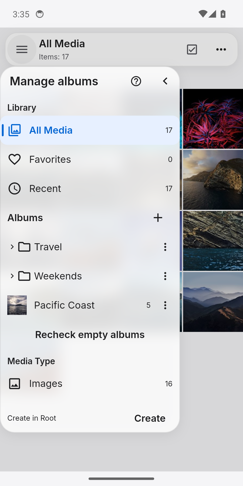
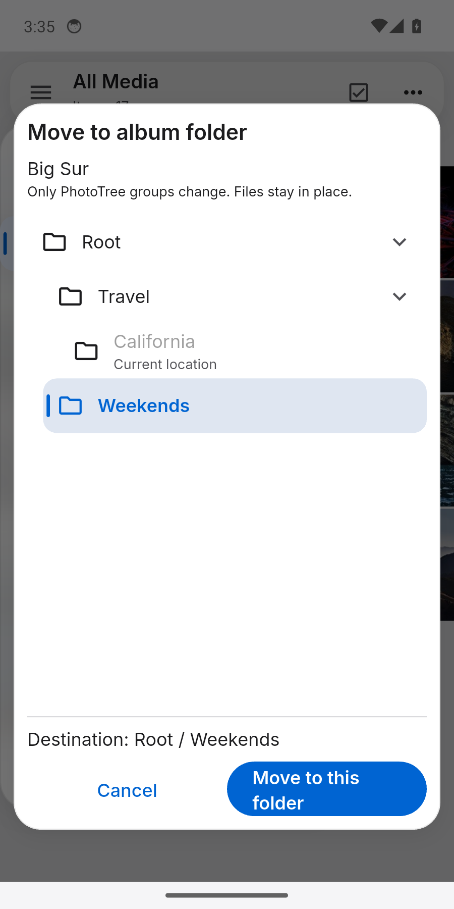
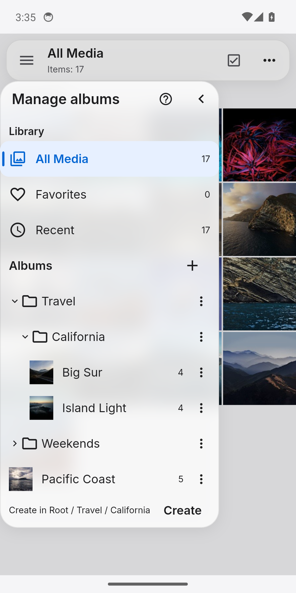
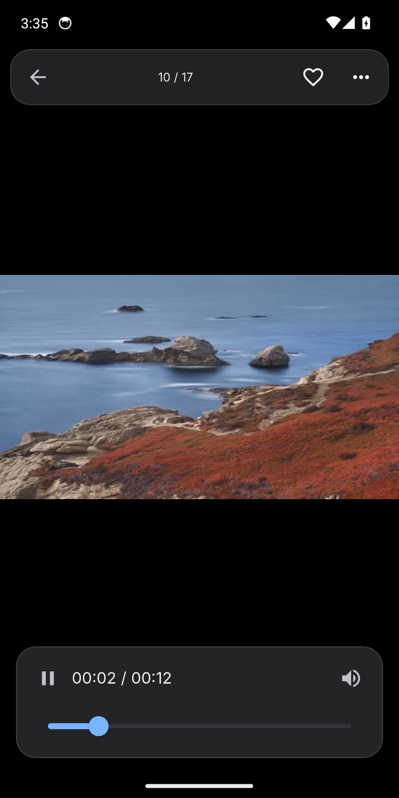
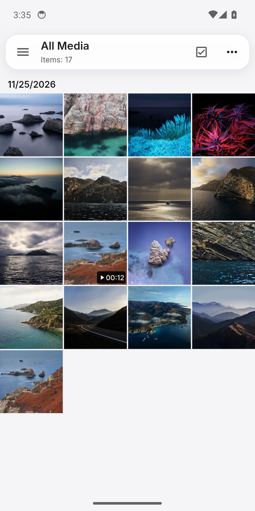

# PhotoTree

English · [简体中文](README.zh-CN.md)

**Turn a messy pile of albums into a tree that works the way you think.**

PhotoTree is an Android app for organizing photos and videos on your phone. It reads the albums you already have, lets you group them into **nested folders**, and lets you browse your library by date. You can browse and organize your library offline.

<p align="center">
  
  
  
  
</p>

## ✨ Highlights

- 🗂️ **Multi-level organization**: put folders inside folders, as deep as you like. *Travel › 2024 › Hangzhou* is one tap away.
- 🔒 **Works offline**: browse photos, play local videos, and organize albums without an internet connection.
- 📱 **Works with your existing albums**: no import, no copies, no extra storage.
- 🕒 **Browse by date**: jump into All Media, Favorite, or Recent, or open any album directly.
- 🖼️ **A viewer that feels right**: pinch to zoom, pan, swipe between items, drag down to return, and play videos in place.
- 🎛️ **You choose how much to share**: grant access to selected photos only and PhotoTree shows just those.

## 🗂️ Organize your albums

Suppose you have albums called *Hangzhou* and *Suzhou*. Create a *Travel* folder in PhotoTree and move both albums into it. The next time you open *Travel*, you’ll see both albums together.

<p align="center">
  
  
</p>

- Folders are just PhotoTree's way of **grouping** albums. The files stay in their original locations on your phone.
- Moving an individual photo from *Hangzhou* to *Suzhou* also moves the file on your phone. Other gallery apps with permission to read it will see the change when they refresh.
- Deleting a photo or video also affects the file on your phone, so be careful.

## 🖼️ Browse photos and videos

<p align="center">
  
  
  
</p>

- Browse the grid from All Media, Favorite, or Recent, or open an album directly.
- Open a photo to zoom and pan, swipe between items, or drag down to return to the grid. You can play videos in the viewer.
- Your Android permissions determine which items appear. If you grant access to selected photos and videos, PhotoTree shows only those items.

## Privacy and permissions

PhotoTree reads photos and videos on your phone and stores album groupings in a local database. You can browse and organize your albums offline without an account.

The verified Android release APK (0.3.12+87) does not request the internet permission (`INTERNET`). It declares `ACCESS_NETWORK_STATE`, which allows it to check the connection status. Debug and profile builds declare the internet permission for Flutter development tools.

On Android versions that support partial access, you can choose which photos and videos PhotoTree can see. Organization backup and restore may request access to original media (`ACCESS_MEDIA_LOCATION`) to fingerprint the original files. When you export a backup, you choose its destination in the system file picker.

## 📦 Platform and development

PhotoTree requires Android 11 (API 30) or later. The interface is built with Flutter. The Android code handles access to shared media and other platform operations.

With the Flutter and Android development tools installed, run these commands from the project root to install dependencies, run static analysis, and execute the tests.

```sh
flutter pub get
flutter analyze
flutter test
```

Build and run the contributor app with your local Android debug certificate. Use the commands below in a macOS or Linux shell. In PowerShell, set `$env:PHOTOTREE_CONTRIBUTOR_DEBUG = "true"` first, then run the Flutter commands. This mode builds only the debug variant, with the application ID `io.github.tantor_d.phototree.contributor`.

```sh
PHOTOTREE_CONTRIBUTOR_DEBUG=true flutter build apk --debug
PHOTOTREE_CONTRIBUTOR_DEBUG=true flutter run --debug
```

Organization backups use the `phototree-organization-backup` identifier. Version 0.3.12 can restore backups exported by 0.3.11+86. It rejects older identifiers before showing a restore preview.

See [Contributing](CONTRIBUTING.md) for the tested toolchain and pull request checklist, and [Security](SECURITY.md) to report a vulnerability.

## License

PhotoTree’s original software is source-available under the [PolyForm Noncommercial License 1.0.0](LICENSE). For commercial uses outside its permitted purposes, obtain separate permission from the rights holder. Third-party components and bundled fonts retain their own licenses.
