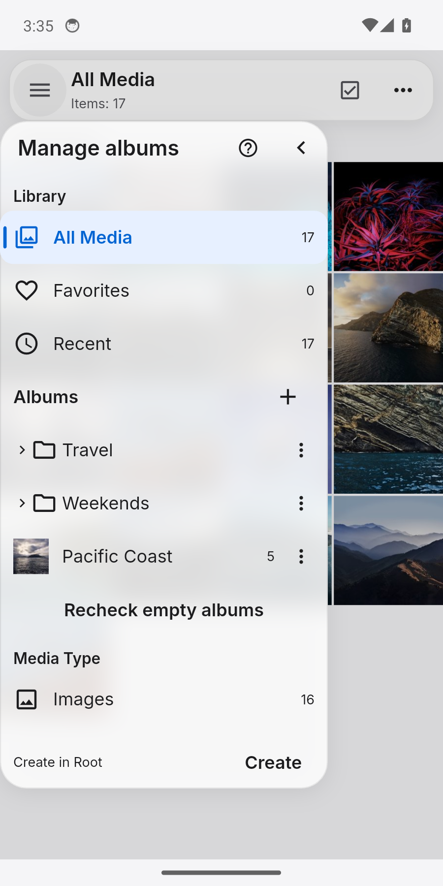
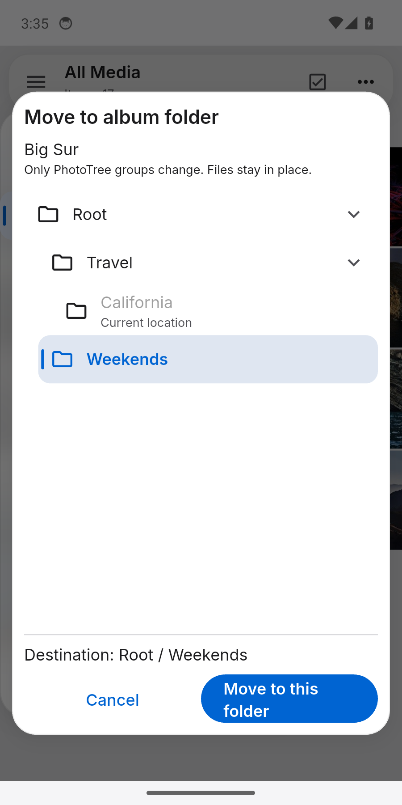
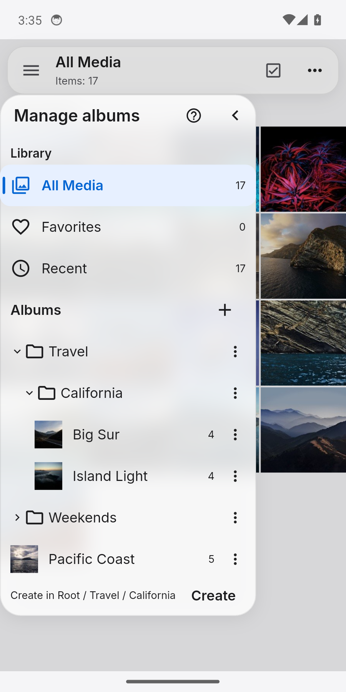
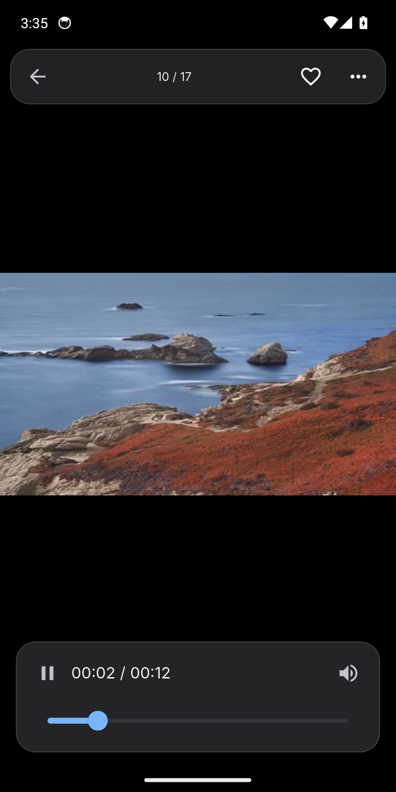
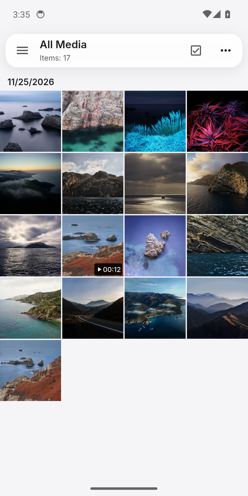

# PhotoTree · 时光树相册

[English](README.md) · 简体中文

**把手机里杂乱的相册，整理成一棵属于你的树。**

PhotoTree 是一款 Android 本地照片整理应用。它读取手机上已有的相册，让你按自己的习惯把相册放进**多级文件夹**，也可以按时间浏览照片和视频。浏览和整理都能离线完成。

<p align="center">
  
  
  
  
</p>

## ✨ 亮点

- 🗂️ **多级整理**：文件夹里可以再建文件夹，层级不限。「旅行 › 2024 › 杭州」，想怎么分就怎么分。
- 🔒 **离线整理**：浏览照片、播放本地视频和整理相册都无需联网。
- 📱 **直接读取现有相册**：不用导入、不复制文件、不占用额外空间，装上就能用。
- 🕒 **按时间浏览**：「所有媒体」「收藏」「最近」一键进入，也能直接打开某个相册。
- 🖼️ **顺手的查看器**：双指缩放、平移、左右翻页、下拉返回，视频可直接播放。
- 🎛️ **你来决定看多少**：只授权部分照片也能用，应用只展示你允许访问的内容。

## 🗂️ 整理相册

假设手机里已经有「杭州」和「苏州」两个相册。你可以在 PhotoTree 里建一个「旅行」文件夹，把两个相册归入其中。下次打开「旅行」，两个相册就在一起。

<p align="center">
  
  
</p>

- 文件夹只是 PhotoTree 里的**分类方式**，相册里的照片在手机上的存储位置保持原样。
- 把「杭州」里的一张照片移动到「苏州」，会移动手机上的实际文件。刷新后，其他有访问权限的图库也能看到新的归属。
- 删除照片或视频同样会影响手机上的文件，请谨慎操作。

## 🖼️ 浏览照片和视频

<p align="center">
  
  
  
</p>

- 从「所有媒体」「收藏」「最近」进入照片网格，也可以直接打开某个相册。
- 点开照片后可以缩放、平移、左右翻页，或向下拖动回到网格。视频可在查看器中播放。
- 浏览内容取决于你授予的照片和视频访问权限。如果只授权了部分媒体，应用只展示可访问的内容。

## 隐私与权限

PhotoTree 在手机上读取照片和视频，相册的分组关系保存在本机数据库中。浏览和整理相册无需账号或网络连接。

已核验的 Android release 安装包（0.3.12+87）没有申请联网权限（`INTERNET`）。它声明了查看网络状态的权限（`ACCESS_NETWORK_STATE`），该权限只允许查询连接状态。debug 和 profile 构建另行声明联网权限，供 Flutter 开发工具使用。

你可以在支持部分授权的 Android 版本上选择应用可见的照片和视频。整理结构的备份与恢复可能请求访问原始媒体（`ACCESS_MEDIA_LOCATION`），以读取原文件并计算指纹。导出备份时，由你在系统文件选择器中指定保存位置。

## 📦 平台与开发

最低系统要求为 Android 11（API 30）。界面使用 Flutter，Android 工程负责共享媒体访问等平台操作。

在配置好 Flutter 和 Android 开发环境后，可以在项目根目录运行依赖解析、静态分析和常规测试：

```sh
flutter pub get
flutter analyze
flutter test
```

贡献者可以用本机的 Android 调试证书构建并运行应用。在 macOS 或 Linux 终端运行以下命令；PowerShell 用户可先设置 `$env:PHOTOTREE_CONTRIBUTOR_DEBUG = "true"`，再执行 Flutter 命令。此模式只提供 debug 包，应用 ID 为 `io.github.tantor_d.phototree.contributor`。

```sh
PHOTOTREE_CONTRIBUTOR_DEBUG=true flutter build apk --debug
PHOTOTREE_CONTRIBUTOR_DEBUG=true flutter run --debug
```

组织备份使用 `phototree-organization-backup` 标识。0.3.12 可恢复 0.3.11+86 导出的备份；旧标识会在显示恢复预览前被拒绝。

开发环境与提交步骤见[贡献指南](CONTRIBUTING.md)，安全问题的反馈方式见[安全说明](SECURITY.md)。

## 许可证

PhotoTree 的原创软件采用 [PolyForm Noncommercial License 1.0.0](LICENSE)，以源码可见方式提供。超出协议许可范围的商业用途须另行取得权利人授权。第三方组件和随附字体沿用各自的许可证。
